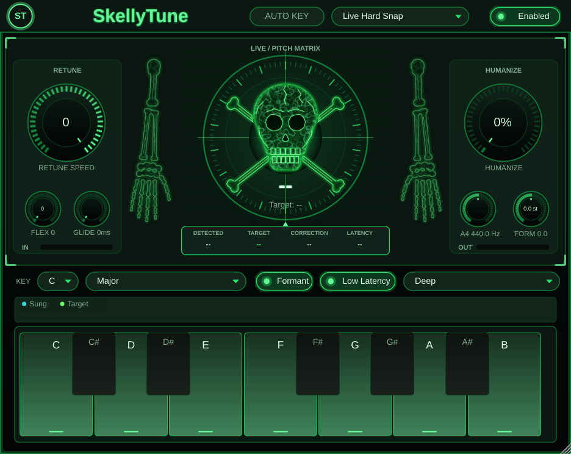

# SkellyTune

Dedicated pitch correction (autotune) plugin built with
[JUCE](https://juce.com). Thick vocal sustain, sharp note snapping,
and formant-preserving TD-PSOLA pitch shifting.

Inspired by Slate Digital MetaTune, Antares Auto-Tune, and
Soundtoys Little AlterBoy.

Ships as:

- **VST3 plugin** — FL Studio, Ableton Live, Reaper, Cubase, Studio One, Bitwig
- **AU plugin** (macOS only) — Logic Pro, GarageBand
- **Standalone app** — runs without a DAW



## Features

| Feature | Description |
|---------|-------------|
| **YIN Pitch Detection** | High-accuracy monophonic pitch tracker with median filtering and confidence scoring |
| **TD-PSOLA Pitch Shifting** | Period-synchronous overlap-add for pitch correction |
| **Sub Bass Range** | Selectable 40 Hz floor (E1 range); existing range indices remain compatible |
| **Formant Preservation** | Keeps natural vocal character even with aggressive pitch shifts |
| **Scale Snap** | Major, Minor, Chromatic, or per-note custom scale with root key selection |
| **Retune Speed** | 0 ms (hard T-Pain snap) to 150 ms (gentle natural correction) |
| **Note Sustain** | Configurable cent threshold — once locked to a note, holds as long as vocal stays in range |
| **Note Stabilizer** | Ignores micro-fluctuations to prevent jittery correction |
| **Humanize** | Reduces correction amount for natural imperfection |
| **Low Latency Mode (Experimental)** | Live overlap-normalized resynthesis with a nominal 1.9 ms shifter budget, transparent unchanged/unvoiced audio, and smoothed cycle joins |
| **Pitch Orb Display** | Real-time visual feedback showing detected note and correction direction |
| **In/Out Heatmap** | Scrolling pitch history showing detected vs corrected pitch |
| **14 Presets** | Live Hard Snap, Hard Snap, Sharp Correct, Natural, R&B Smooth, Trap Vocal, Gospel, and more |
| **Neon Green Interface** | Original skull/radar and skeleton artwork, refined neon controls, readable parameter values, pitch history, and interactive scale keyboard |


## Technical Design

### Why TD-PSOLA?

Previous implementations used fixed-size
grains (256 samples) for pitch shifting, which caused:
- Phase discontinuities at grain boundaries
- Metallic / robotic artifacts
- Formant shifting (chipmunk / barrel effect)

TD-PSOLA (Time-Domain Pitch-Synchronous Overlap-Add) addresses these problems:
1. **Grains are period-length** — aligned to the detected fundamental
2. **Normalized Hann-window overlap** — smoother joins between cycles
3. **Pitch changed via placement rate** — grain content (formants) stays intact

### Note Sustain Logic

Once the engine locks onto a scale note, it holds that note as long as
the incoming vocal stays within a configurable cent threshold (default
50 cents). This prevents jittery switching between adjacent notes on
sustained vocals and is key to getting that "painted" autotune sound.

## License

See [installer/eula.txt](installer/eula.txt).


## Real-time tuning and quality checks

Start with **Live Hard Snap**, then choose the song's key/scale and an appropriate
voice range. This preset enables Low Latency with fastest retuning and no Humanize,
Flex-Tune or Glide softening. Existing factory program indices and parameter IDs
are preserved. For gentler correction, turn Retune Speed left (toward 100) or increase Humanize.

Low Latency remains opt-in. Its shifter budget is 84 samples at 44.1 kHz (1.905 ms),
92 at 48 kHz, and 183 at 96 kHz. Standard mode retains its range-dependent delay
(726 samples / 16.46 ms for Deep at 44.1 kHz). These are reported audio delays,
not pitch-detection response times or complete device/DAW round-trip latency.
Detection needs several waveform cycles, especially for bass notes. Analysis and
correction now update about every 2 ms without increasing the audio delay.

Both modes use causal, normalized live-grain overlap. Standard mode no longer uses
the older window-compressed, block-scheduled shifter, which could reshape unpitched
attacks. Unchanged/unvoiced audio uses a latency-matched dry path. Short unity-ratio
crossings retain resynthesis phase rather than repeatedly crossfading unrelated
phases during vibrato. A small target hysteresis suppresses chatter near scale
boundaries; it releases a note when the note mask disallows it. Pitch-motion
prediction uses smoothed velocity to avoid amplifying detector jitter and aligns
Standard mode to the older audio it reads.

Bypass keeps the audio delay history warm, while re-enable and mode changes
invalidate detector history explicitly. Re-enabling tuning no longer inserts a
latency-length silence gap. Corrected audio fades to delayed dry over 3 ms on bypass,
avoiding an abrupt phase switch. Changing latency mode/range still resets resynthesis
and asks the host to update delay compensation; do that between takes.

Key/scale automation works with the editor closed. The piano projection updates on
JUCE's message thread, while audio follows the requested scale immediately. Custom
piano masks survive state restoration, including saves made immediately after key
changes. Static UI artwork and controls are cached rather than redrawn every frame.

Run the focused regressions without downloading JUCE:

```sh
cmake -S . -B build/low-latency -DCMAKE_BUILD_TYPE=Release -DSKELLYTUNE_LOW_LATENCY_TESTS_ONLY=ON
cmake --build build/low-latency --parallel 3
ctest --test-dir build/low-latency --output-on-failure
```

The suite covers exact delayed passthrough in both modes, 96 harmonic pitch-shift
cases at 40/80/220/880 Hz across 44.1/48/96 kHz, integrated correction at
44.1 kHz/96 samples, pitch wobble and target stability under 30-cent vibrato,
noise-to-voice phrase attacks, fast legato/octave jumps, corrected-vocal bypass
transitions, stereo phase, 32–512-sample
callback consistency, callback allocations, mode resets and sample-rate changes.
The runner reports timing rather than enforcing a machine-dependent wall-clock
threshold. `SKELLYTUNE_DSP_TESTS_ONLY` is a compatibility alias for this suite.
With GCC or Clang, add `-DSKELLYTUNE_ENABLE_SANITIZERS=ON` to check memory safety
and undefined behavior.

The compiled VST3 also has an optional host regression (used by Windows CI):

```sh
python -m pip install pedalboard==0.9.26 numpy==2.2.6
python tests/plugin_host_smoke.py build/HumHouseVocalTune_artefacts/Release/VST3/SkellyTune.vst3
```

It renders both modes at 44.1 kHz/96 samples without an editor, checks the corrected
pitch after host automation, and verifies custom piano masks and state round trips.

These are synthetic checks. Real-vocal artifacts, formant quality, device/driver
performance and DAW loopback latency still need listening and host validation.
For FL Studio at 44.1 kHz/96 samples, each interface buffer is about 2.18 ms;
interface and driver latency are additional to the plugin delay.
